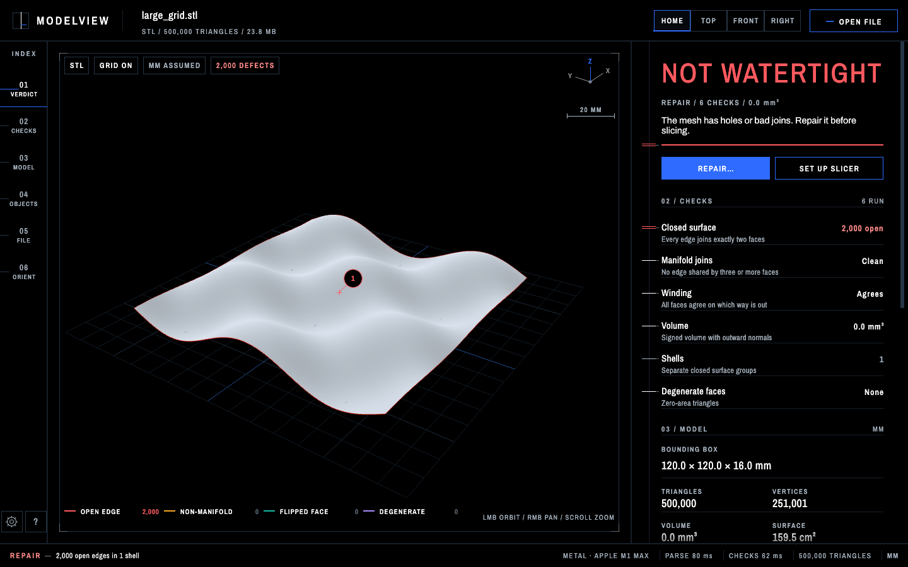
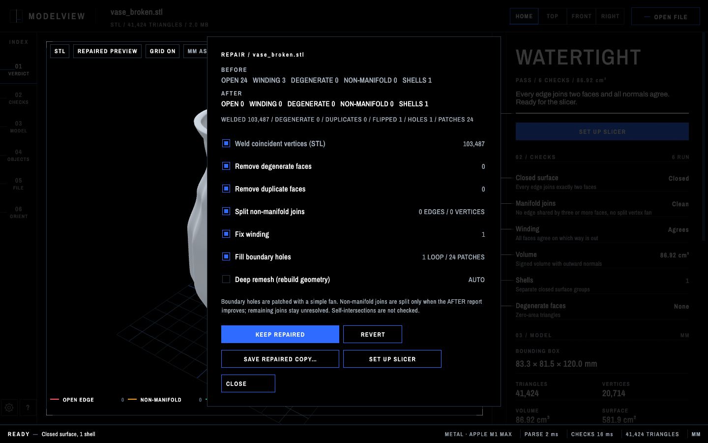
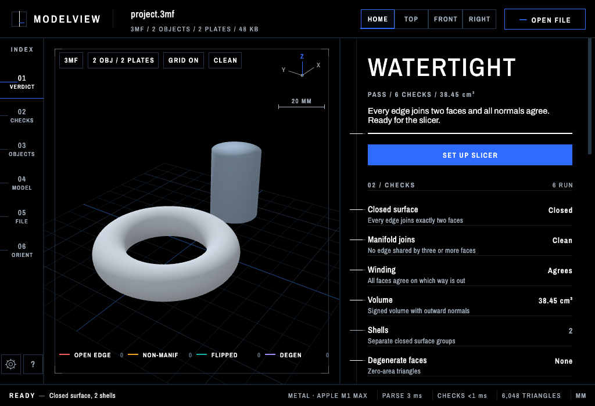
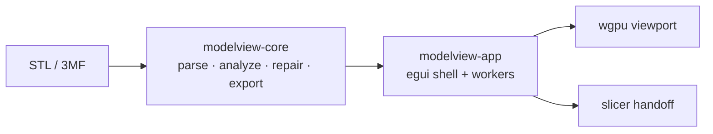

<div align="center">

# ModelViewer

**Find the open edge before the hotend does.**

[](https://github.com/jfmiller52/ModelViewer/blob/main/LICENSE)
[](https://github.com/jfmiller52/ModelViewer/stargazers)
[](https://github.com/jfmiller52/ModelViewer/releases/latest)
[](https://www.rust-lang.org/)
[](https://github.com/emilk/egui)


<sub>ModelViewer. The binary is `modelview`. The window says MODELVIEW. The naming committee has been dissolved.</sub>

</div>

ModelViewer is a native STL/3MF printability inspector for people who would rather discover a 0.04 mm hole now than seven hours into a print. It parses the mesh locally, marks the suspicious bits, and can hand the exact file to your slicer. It is fast, private, and honest about what it cannot see.

The vase above is the built-in sample: 24 open edges, three flipped faces, and no shame. It is not a slicer. It has no opinions about temperatures, retraction, or your support settings. It has very strong opinions about holes.

## Why this exists

Slicers are excellent at slicing. They are less excellent at explaining that your mesh is a topological rumor. ModelViewer is the pre-flight check: geometry first, evidence second, and no "it should be fine" in between.

No cloud. No account. No telemetry. Your questionable Benchy stays on your disk.

## The useful bits

- **STL and 3MF, interpreted properly.** Binary/ASCII STL, 3MF units, components, build transforms, plates, Bambu project metadata, and part colors.
- **Real topology checks.** Open edges, non-manifold edges, winding, signed volume, shells, and degenerate faces, with numbered defect markers and filters.
- **Defect Theater.** Click a callout or press `D`: the camera flies to the defect, the model goes ghost, a White focus frame holds the area, and a topology loupe reads local valence and winding. No RGB, no bloom; this is a workshop.
- **Safe repair with receipts.** Preview five boring, useful passes, compare the AFTER report, then Keep, Revert, save a repaired STL/3MF, or send it. The source file is never overwritten.
- **Slicer handoff.** Detects Bambu Studio, OrcaSlicer, PrusaSlicer, UltiMaker Cura, or a custom app/executable, remembers the choice, and opens the current file. It does not install the slicer for you.
- **Large binary STL without the spinner.** The first triangle chunks appear as a live flat mesh while a six-cell analysis filmstrip counts the checks. The smooth authoritative scene replaces it at the handoff.
- **Large 3MF recovery.** Bambu packages with external `p:path` object parts offer **FIX ON LOAD**; the package is flattened in memory, plates and names survive, and broken parts are skipped and counted. The source is not modified.
- **Orientation Adviser.** Ranks candidate poses on an assumed 256 mm bed by height, support risk and bed contact, then rotates the specimen into place. Preview only; the slicer still owns the final pose.
- **Part colors.** If the 3MF already defines them, the viewport and object-row swatches use them. Undefined parts keep the cool specimen palette.

## Screenshots

<div align="center">


<sub><strong>Left:</strong> Defect Theater, where a hole gets a spotlight. <strong>Right:</strong> an 8-plate, 19,275,922-triangle Bambu 3MF after FIX ON LOAD, wearing its own Army Dark Green, Ash Grey and Charcoal Black parts.</sub>




<sub><strong>Left:</strong> the Orientation Adviser has a 256 mm bed and a plan; your printer may have notes. <strong>Right:</strong> 500,000 triangles streaming in while the analysis filmstrip counts.</sub>




<sub><strong>Left:</strong> safe repair, five calm passes, and an original file that survives the meeting. <strong>Right:</strong> the same report at 1024×700, with shorter legend labels and no tiny-type apology.</sub>

</div>

<sub>All captures are release screenshots at 1440×900 except the explicit 1024×700 layout check. Each PNG has a `<name>.png.json` provenance sidecar.</sub>

## Quick start

```sh
git clone https://github.com/jfmiller52/ModelViewer.git
cd ModelViewer
cargo run --release
```

Then drag an STL/3MF onto the window, press **Open file**, or pass a path directly:

```sh
cargo run --release -- samples/vase_broken.stl
```

Prebuilt **macOS (Apple Silicon)** builds are on the [Releases](https://github.com/jfmiller52/ModelViewer/releases) page; they are ad-hoc signed, not notarized. Windows and Linux build from source.

Requirements: Rust 1.95 or newer and a GPU with Metal (macOS), DirectX 12 or Vulkan (Windows), or Vulkan (Linux). No webview, no Electron, no runtime services.

macOS is the environment exercised most in this repository. Windows is a primary compile target; Linux is best-effort. The release profile uses thin LTO.

## What it checks

| Check | A failure means |
|---|---|
| **Closed surface** | An edge has only one adjacent face: a hole or an open boundary. |
| **Manifold joins** | An edge is shared by three or more faces. |
| **Winding** | The two faces on an edge disagree about which way is out. |
| **Degenerate faces** | Zero-area or invalid triangles. |
| **Volume** | The signed volume is zero or inward-facing. |
| **Shells** | Separate closed surfaces; informational, not a failure. |

The verdict is the worst per-object result. A multi-object project passes only when every object passes.

## What it refuses to do

| It will not... | Because... |
|---|---|
| Slice your model | That is the slicer's job, and it has better information than a mesh inspector. |
| Detect self-intersections | Not in v1. The report does not guess. |
| Predict wall thickness, overhangs, supports, print time or material use | Those need slicing context. Orientation uses a down-facing area proxy, not a support solver. |
| Heal non-manifold edges | Safe repair counts them and leaves them in the AFTER report. |
| Fix mesh topology during 3MF recovery | Recovery resolves the package structure; the checks and Repair flow still own the mesh. |
| Know your real print bed | The Orientation Adviser assumes **256 × 256 × 256 mm**, says so, and changes nothing on disk. |
| Invent STL units | STL has none. ModelViewer assumes millimetres and labels the assumption. |
| Guarantee a good print | A watertight mesh is necessary, not sufficient. The printer and slicer still get the final say. |

A few extra honest notes: part colors currently come from Bambu-style `model_settings.config` / `project_settings.config` metadata; standard 3MF `basematerials` are not parsed yet. Large binary STLs get the progressive path; 3MF and ASCII STL use the regular loader. Very large 3MF recovery is a package fix, not a mesh fix, and can take a while. The final smooth GPU handoff after a large load is still synchronous.

## Keyboard

| Action | Input |
|---|---|
| Orbit / pan / zoom | Left drag / right or middle drag / scroll or pinch |
| Frame scene | `F` |
| Home / Top / Bottom / Front / Back / Left / Right | `Ctrl/⌘ + 1 … 7` |
| Previous / next object | `↑` / `↓` |
| Frame selected object | `Enter` |
| Show / hide selected object | `Space` |
| Defect Theater / next defect | `D` |
| Orientation Adviser | `O` |
| Inspector / grid / help | `I` / `G` / `H` |
| Open file / settings | `Ctrl/⌘ + O` / `Ctrl/⌘ + ,` |
| Send to slicer | `Ctrl/⌘ + Enter` |
| Repair preview | `R` |
| Close sheet / exit theater / reset orientation | `Esc` |

The in-app `H` overlay has the full list. Camera presets follow BambuStudio where it makes sense; `F` frames the scene instead of pretending to place a face on a bed.

## How it works



`modelview-core` owns formats, mesh welding, topology checks, safe repair, orientation scoring and STL/3MF writing. `modelview-app` owns the eframe/egui shell, the wgpu viewport, camera, workers and local persistence. The two crates are deliberately separate so the geometry truth can be tested without opening a window.

## Project layout

```
ModelViewer/
├── crates/
│   ├── modelview-app/     # eframe/egui shell, wgpu viewport, camera, theme
│   └── modelview-core/    # parsers, analysis, repair, orientation, export
├── docs/                  # shipped screenshots and provenance
├── samples/               # synthetic test geometry
├── scripts/               # sample and icon generators
├── Cargo.lock
├── Cargo.toml
├── DESIGN.md
├── LICENSE
├── PRODUCT.md
└── README.md
```

## Build and test

```sh
cargo build --release
cargo test --workspace
cargo clippy --all-targets
cargo fmt --all --check
```

The test suite covers binary/ASCII STL, 3MF units/components/plates, external-part recovery, colored part metadata, safe repair, winding/cavity cases, streaming scans, orientation scoring, slicer commands, working-file policy and persistence.

<details>
<summary>Developer switches for screenshots and state checks</summary>

```sh
cargo run --release -- --repair-open
cargo run --release -- --theater-demo
cargo run --release -- --orientation-demo
cargo run --release -- --settings-open
cargo run --release -- --recover-demo --file '/path/to/large.3mf'
cargo run --release -- --file large.stl --screenshot /tmp/live.png --screenshot-live
```

Screenshot mode writes a sidecar JSON with source, timestamp, app version and pixel size so shipped rasters stay traceable.

</details>

## Documentation

| Resource | Description |
|---|---|
| [`DESIGN.md`](DESIGN.md) | The Blueprint Plate visual system: type, color, components, motion and rules. |
| [`PRODUCT.md`](PRODUCT.md) | Durable product intent, users, constraints and non-goals. |
| [`samples/README.md`](samples/README.md) | Synthetic fixtures and their deliberately broken geometry. |
| [`crates/modelview-core`](crates/modelview-core) | Parsers, checks, repair, orientation and export. |
| [`crates/modelview-app`](crates/modelview-app) | Native eframe/egui application and wgpu viewport. |
| [`docs/modelview.png.json`](docs/modelview.png.json) | Provenance for the hero screenshot. |
| [`LICENSE`](LICENSE) | MIT license for the code and synthetic samples. |

## Contributing

Bring a mesh that misbehaves. Issues with a reproducible file, expected result and actual result are gold. PRs should keep the geometry truth in `modelview-core`, keep the UI honest, and leave the source files of users alone.

Before opening a PR:

```sh
cargo fmt --all --check
cargo clippy --all-targets
cargo test --workspace
```

<a href="https://github.com/jfmiller52/ModelViewer/graphs/contributors">
  
</a>

## License

The application code and synthetic sample geometry are MIT-licensed. The Archivo and Archivo Narrow fonts are under the SIL Open Font License 1.1; the license ships at `crates/modelview-app/assets/fonts/OFL.txt`. The app icon is generated for this project and carries no third-party imagery.

---

<div align="center">

[](https://star-history.com/#jfmiller52/ModelViewer&Date)

</div>
