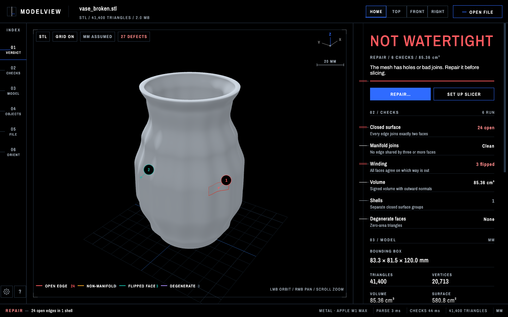
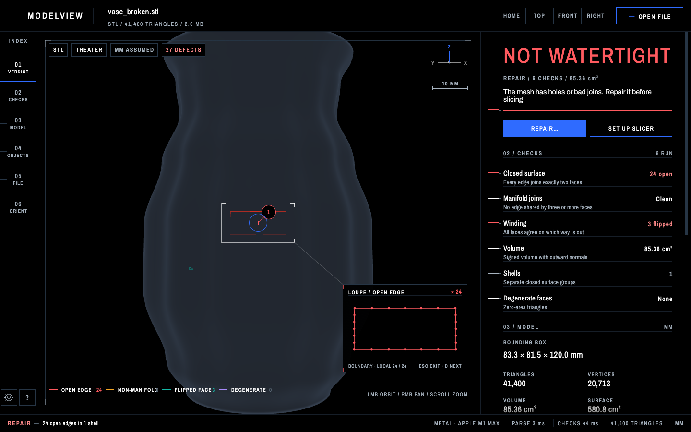
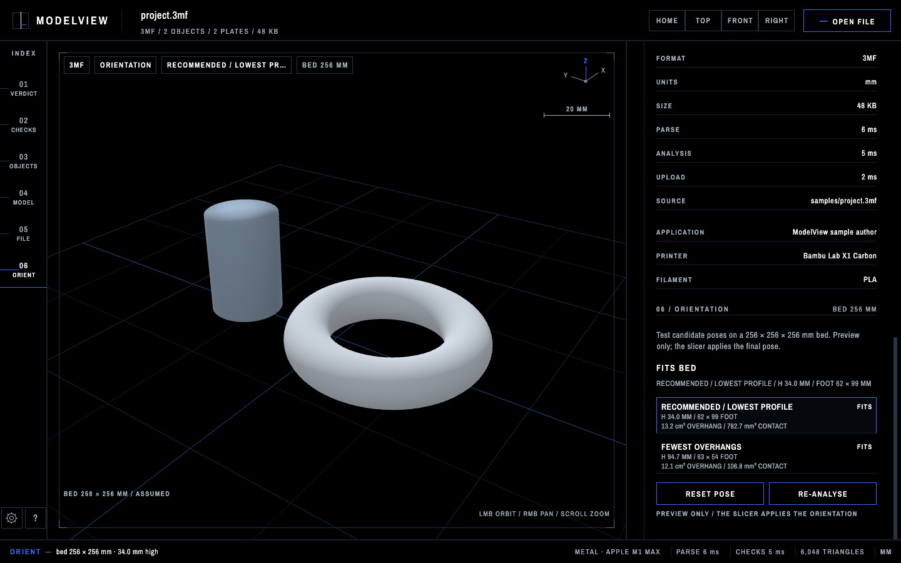
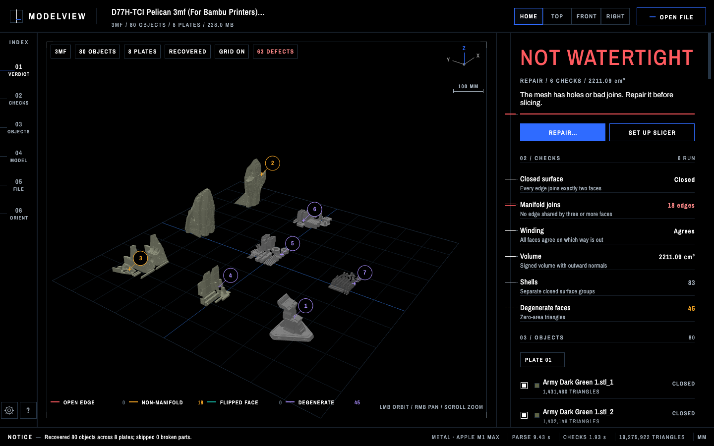

# ModelView

A fast, local STL and 3MF printability inspector for Windows and macOS, with an optional Linux build. Native Rust, a wgpu viewport, BambuStudio-style navigation, and a report that tells you whether the mesh is ready for the slicer before you open one. Confirm a model and hand the exact file to your slicer, or preview a safe repair first.



The screenshot is a 1440×900 capture of `samples/vase_broken.stl`; provenance is in `docs/modelview.png.json`. The sample is deliberately broken: 24 open edges and one flipped triangle.



The same file in Defect Theater: the camera has flown to the largest defect, the specimen is a ghost, the White focus frame holds the open edge, and the loupe reads the boundary's local valence.


A synthetic 500,000-triangle binary STL opens progressively: the flat live mesh appears after the first chunks while the six-cell filmstrip and side counts settle. The authoritative smooth scene replaces it when the analysis lands.



The Orientation Adviser tests poses on an assumed 256 × 256 × 256 mm bed, ranks the candidates, and rotates the specimen onto the recommended pose. The source file is not changed.



A 228 MB Bambu package with 19,275,922 triangles and eight plates, opened through **FIX ON LOAD**. External object parts were flattened, the plates and object names were kept, and the recovered scene is marked `RECOVERED`; the source file was not modified. The objects use the package's own Army Dark Green, Ash Grey and Charcoal Black part colors, with matching swatches in the object rows.

## What it does

- Opens binary and ASCII STL and 3MF, with no upload and no project setup.
- 3MF project semantics: object meshes, components, build items, transforms, model units, plates, and Bambu-style `model_settings.config` / `project_settings.config` metadata.
- Checks whether a mesh is watertight: open edges, non-manifold edges, inconsistent winding, signed volume, shell count, and degenerate faces.
- Marks defects on the mesh with spectral hairlines and numbered callout locators; the legend counts and filters each defect type.
- Defect Theater: click a callout or press `D` and the camera flies to the defect, ghosts the specimen, frames the focused defect in White, and docks a topology loupe with local valence, winding arrows and non-manifold knots; `Esc` returns the camera.
- No-wait large models: large binary STLs stream a flat live mesh and a six-cell analysis filmstrip before the final smooth report lands. The viewport is interactive while the worker reads and checks.
- Large 3MF recovery: when a package fails because objects live in external model parts, the failure screen offers **FIX ON LOAD**. Recovery resolves the parts, preserves every plate and object name, skips broken parts, and opens the full scene without changing the source.
- Defined 3MF part colors: Bambu `model_settings.config` extruder assignments are matched to `project_settings.config` filament colors; the viewport and object-row swatches show those colors. Dark print colors are lifted slightly for the black plate; undefined parts keep the cool specimen palette.
- Orientation Adviser: tests candidate poses on an assumed 256 × 256 × 256 mm bed, reports bed fit, height, footprint, overhang and contact, and animates the specimen to the recommended pose. Preview only; the source file is never rewritten.
- Reports triangles, unique vertices, bounding box and dimensions, volume, surface area, shells, open edges, file size, parse time, analysis time, and GPU upload time.
- Renders with wgpu 30 through egui-wgpu: MSAA, a smooth-shaded clay mesh, a floor grid, and a custom per-object tint for multi-object scenes.
- Frames the scene automatically, then keeps the viewport pure; chrome recedes.
- Detects Bambu Studio, OrcaSlicer, PrusaSlicer, UltiMaker Cura and a custom app/executable; remembers the choice and opens the current file directly.
- Previews safe repairs for any non-watertight scene: weld coincident vertices, remove degenerate and duplicate faces, fix winding, and fill boundary holes. Keep, Revert, save a repaired STL/3MF, or send the repaired copy.
- Never overwrites the source. Saved repairs default to `<stem>.repaired.<ext>`; temporary handoff copies live in the OS temp directory.

## Quick start

```sh
cargo run --release -- samples/vase_broken.stl
```

Or build the binary:

```sh
cargo build --release
# macOS / Linux: target/release/modelview
# Windows:       target\release\modelview.exe
```

Drop a file on the window, use **Open file**, or pass a path. `cargo run --release` with no file opens the empty title sheet, including a built-in sample loader.

Requirements: Rust 1.95 or newer; a GPU with Metal (macOS), DirectX 12 or Vulkan (Windows), or Vulkan (Linux). No webview, no Electron, no runtime services.

### Platform notes

- **macOS** is the build verified in this repository. The release binary is universal only if you build it that way; the default build targets the host architecture.
- **Windows** is a primary target and uses the same eframe/wgpu/rfd stack. Build with the MSVC toolchain; release builds hide the console window.
- **Linux** is optional: install Vulkan drivers and a desktop portal (or `zenity`) for the file dialog. Wayland and X11 are enabled through eframe's defaults.

## Viewport and keyboard

The viewport follows BambuStudio's hands:

| Action | Input |
|---|---|
| Orbit | Left mouse drag |
| Pan | Right or middle mouse drag |
| Zoom toward cursor | Scroll / trackpad pinch |
| Frame the whole scene | `F` |
| Home / Top / Bottom / Front / Back / Left / Right | `Ctrl/⌘ + 1 / 2 / 3 / 4 / 5 / 6 / 7` |
| Select next / previous object | `↑` / `↓` when no control has focus |
| Frame selected object | `Enter` |
| Defect Theater / next defect | `D` |
| Orientation Adviser | `O` |
| Show / hide selected object | `Space` |
| Inspector on / off | `I` |
| Grid on / off | `G` |
| Help overlay | `H` |
| Open settings | `Ctrl/⌘ + ,` |
| Send to slicer | `Ctrl/⌘ + Enter` |
| Repair preview (when not watertight) | `R` |
| Close the open sheet; repair reverts; exit Defect Theater | `Esc` |
| Reset the orientation preview | `Esc` when no sheet and no theater are open |
| Clear selection | `Esc` when no sheet, theater or orientation is open |
| Open file | `Ctrl/⌘ + O` |

`F` is a viewer adaptation: BambuStudio uses it for face-on-bed placement, which does not exist here, so ModelView uses it to frame the scene. The orbit, pan, zoom, and view presets are otherwise the BambuStudio scheme.

## Defect Theater

`D`, or a click on any numbered defect callout, focuses that defect. The camera flies outward to the defect's side; the grid yields; the specimen becomes a near-black ghost; the focused defect keeps its ink while the other defect lines drop to 18%. A 1px White focus frame with corner ticks traces the local defect bounds, the selected marker keeps a 1px Electric Blue ring, and a topology loupe docks above the legend.

The loupe is a local reading of the same analysis, not new geometry: open-edge endpoints are labelled only where valence is 1 or 3+, flipped-winding segments carry arrows, non-manifold segments carry a knot dot, and degenerate faces draw a flattened violet triangle. The header carries the kind and total count; the footer carries the local count and `ESC EXIT · D NEXT`. At 1024 the plate contracts to 208×154 and the footer shortens.

`D` cycles to the next visible, enabled defect. `Esc` returns the camera and fades the ghost. Dragging, scrolling or pinching cancels the flight but keeps theater for inspection; `F`, a camera preset, a new file or a repair ends theater. The side report stays live throughout. There is no idle animation.

## No-wait large models

Binary STL files above 100,000 triangles take the streaming path. The first triangle chunks are uploaded to a flat-shaded live GPU mesh, the camera follows the growing bounds until you orbit/pan/zoom, and the viewport is usable before the file is fully read. The grid yields; the tags read `LARGE MODEL / STREAMING`; the side report becomes a live scan.

A six-cell **analysis filmstrip** sits above the viewport bottom: OPEN EDGE, NON-MANIFOLD, WINDING, VOLUME, SHELLS and DEGENERATE. Counts animate toward the streaming scan; a blue scan line tracks the triangle fraction. The scan is provisional by design; the authoritative analysis replaces it and the smooth mesh is uploaded at the handoff. The status bar shows `SCAN`/`VERIFY`. At 1024 the filmstrip labels shorten so all six cells fit.

The stream path is intentionally limited to binary STL; 3MF and ASCII STL continue on the regular loader.

## Orientation Adviser

Press `O` or click the sixth rail tick, `ORIENT`. The section tests candidate poses on an assumed **256 × 256 × 256 mm** bed and reports:

- **Recommended** pose by a normalized height/support-risk/contact score.
- **Lowest profile** and **most contact** alternatives when distinct.
- Height, footprint, overhang area and bed contact for each.
- `FITS BED` or `NO BED FIT`; a non-fitting pose is marked `OVER`.

The selected pose animates the specimen onto a GPU bed grid at z=0 and frames the camera. `RESET POSE` returns to the loaded pose; `RE-ANALYSE` runs the candidate worker again; `Esc` resets the preview. This is a preview only: ModelView never rewrites the source and the side report keeps the original defect facts. The bed size is an explicit assumption, not a stored printer profile.

## Large 3MF recovery

Large Bambu-style packages sometimes keep each object in its own `.model` part and reference it with `p:path`. The standard opener cannot resolve those references and reports `3MF references an external object part`. Instead of a dead end, the failure screen offers **FIX ON LOAD**:

- The recovery parser reads the external object parts on demand, composes their transforms, and flattens the meshes.
- `Metadata/model_settings.config` is still applied, so the plates, plate names and object names survive. On the included 8-plate test package, recovery produced **80 objects, 8 plates and 19,275,922 triangles**.
- Broken or missing parts are skipped and counted; a recovery that finds nothing remains an error.
- The recovered scene is marked `RECOVERED`; the source file is never modified. Sending exports a temporary recovered 3MF rather than re-opening the broken source. Part colors from `model_settings.config` / `project_settings.config` are applied to the mesh and the object-row swatches; the exporter writes the extruder assignment back into the model settings so a repaired/recovered 3MF keeps its colors.
- The recovery worker can take a while on multi-gigabyte packages; the loading state shows `RECOVERING / RESOLVING EXTERNAL OBJECT PARTS` and the source path remains visible.

This is package recovery, not a promise that the mesh topology is clean. The normal checks and Repair flow still run after the scene opens.

## Slicer handoff

The first time you use **Send to slicer**, ModelView opens **Settings / Slicer**. Detection scans the usual macOS `/Applications` locations and the Windows program roots for Bambu Studio, OrcaSlicer, PrusaSlicer and UltiMaker Cura; **Browse…** accepts any other `.app` or executable, and the custom choice is kept as its own row. The choice is stored with eframe's persistence and survives a restart; **Rescan** keeps a still-valid saved choice, and a path that no longer exists is marked **MISSING**.

The verdict block carries the handoff:

- A watertight model gets one filled **Send to <slicer>** action. A broken model gets a filled **Repair…** beside an outlined send action. With no slicer configured, the send action reads **Set up slicer** and opens Settings. `Cmd/Ctrl+Enter` sends.
- If the scene is untouched and the original file still exists, that path is sent.
- If a repaired copy has been saved for the current preview, the saved path is sent.
- Otherwise ModelView writes a temporary copy of the current scene in the OS temp directory and sends that; the status bar says it is temporary. This also covers the built-in sample and an original that has been moved or deleted.
- Paths are passed as `Command` arguments, never through a shell. A missing or invalid slicer path produces an inline notice, not a crash.

## Safe repair

**Repair…** (or `R` while the model is ready and not watertight) opens a preview sheet with before/after counts. The repair is deliberately conservative and runs on a worker thread:

| Pass | What it does |
|---|---|
| Weld coincident vertices | Joins positions within the weld tolerance. STL always welds; this row is locked on for an STL scene. |
| Remove degenerate faces | Drops zero-area and invalid triangles. |
| Remove duplicate faces | Drops exact duplicate triangles. |
| Fix winding | Makes each closed shell consistently outward; nested cavity shells stay inward. |
| Fill boundary holes | Patches boundary loops with a simple centroid fan. |

Non-manifold edges are counted and left unresolved. Self-intersections are **not** detected or repaired. A still-failing preview is shown in the AFTER line and the sheet says `NO SAFE REPAIR APPLIED` when nothing changed; Keep is disabled in that case.

- **Keep repaired** closes the sheet and marks the live scene `REPAIRED`. Save before Keep if you want a permanent copy; Send can still export the kept scene.
- **Revert** or `Esc` restores the original scene.
- **Save repaired copy…** writes the current preview in the source format. The default name is `<stem>.repaired.stl` or `<stem>.repaired.3mf`; the source is never overwritten.
- **Send to <slicer>** sends the saved repaired copy if one exists, otherwise a temporary repaired copy. A 3MF keeps its objects and plates and copies the source's `Metadata/project_settings.config`; ModelView regenerates `Metadata/model_settings.config` so object ids are not stale. If the project settings themselves carry object or plate ids, ModelView replaces them with a minimal printer/filament context from the loaded scene.

The viewport shows a `REPAIRED PREVIEW` tag while the sheet holds a live preview and `REPAIRED` after Keep. The side report follows the preview; the original scene and report stay in memory until Revert.

## Files and units

- **STL**: binary and ASCII. STL carries no unit; ModelView assumes millimetres and says so in the report.
- **3MF**: millimetre, micron, centimetre, inch, foot, and metre model units are converted to millimetres. Objects, components and build-item transforms are flattened into the scene; plates and project metadata are shown when present.
- Unrecognised or broken files show a plain error state with the underlying reason.

## Printability checks

| Check | Failure means |
|---|---|
| Closed surface | An edge has only one adjacent face (a hole or an open boundary). |
| Manifold joins | An edge is shared by three or more faces. |
| Winding | The two faces on an edge disagree on orientation (a flipped face). |
| Volume | The signed volume is zero or inward-facing. |
| Shells | Separate closed surfaces; informational, not a failure. |
| Degenerate faces | Zero-area triangles, plus invalid indices. |

Self-intersection, wall thickness, overhang angle, print time, and material estimates are **not** checked in v1. The report does not invent them. Safe repair does not change that: it fixes only the five passes above, and non-manifold edges remain in the after report. The verdict is the worst per-object result: a multi-object project passes only when every object passes.

## Performance

The app is built for the file-open moment:

- Parsing runs in a worker thread; the UI stays responsive and shows an indeterminate loading line.
- Binary STL parsing is parallelised with Rayon; welding and topology checks are single-pass over shared vertices.
- The wgpu viewport renders with 4× MSAA offscreen at the window's physical resolution, with one draw per object plus hairlines for the grid and defects.
- The status bar shows the real parse and check timings; it does not show a fake idle FPS. On the authoring machine (Apple M1 Max), the 41,400-triangle sample parses in ~1 ms and checks in ~4 ms; the 3MF project parses in ~3 ms and checks in under 1 ms. Larger meshes are bounded by file read and welding, not by the frame loop.
- The release profile uses thin LTO and four codegen units.

## Samples and provenance

- `samples/vase_broken.stl` — 41,400-triangle ribbed vase with a hollow cavity, one deliberate 6×6 hole (24 open edges) and one flipped triangle (3 flipped edges). 85.36 cm³ of material.
- `samples/project.3mf` — a two-object, two-plate print project with Bambu-style plate and project metadata; both objects are watertight.
- Both are synthetic, generated by `scripts/make_samples.py`; no third-party model files are included. The app embeds the vase sample; both files ship under `crates/modelview-app/assets/samples/` and `samples/`.
- The app icon is generated by `scripts/make_icon.py`; the Archivo fonts are under the SIL Open Font License (see `crates/modelview-app/assets/fonts/OFL.txt`).

## Project layout

```
crates/
  modelview-core/   formats, mesh welding, topology and printability analysis; unit-tested
  modelview-app/    eframe/egui shell, wgpu viewport, camera, theme, samples, icon
samples/            authored sample geometry and its provenance
scripts/            sample and icon generators
docs/               the shipped screenshot and its provenance
DESIGN.md           the recorded visual system
PRODUCT.md          durable product context
.impeccable/        development design artifacts (review captures are working material)
```

## Development

```sh
cargo test
cargo clippy --all-targets
```

The core crate has tests for binary/ASCII STL, welding, closed vs. open topology, winding, signed volume, scene summaries, 3MF units, build-item transforms, component flattening, safe repair (including nested cavities and non-planar hole loops), and STL/3MF writing. The app crate tests slicer command construction, detection against temporary roots, working-file selection, settings round-trips, and the repair preview/worker path.

Development-only flags for visual checks:

```sh
# Render the first viewport to a PNG and exit.
cargo run --release -- --file samples/vase_broken.stl --screenshot .impeccable/review/check.png --size 1440x900

# Open the controls overlay on launch; hide the inspector; force a visible focus row.
cargo run --release -- --help-open --inspector-closed --focus-demo

# Open the slicer settings sheet, or the repair sheet on the built-in broken sample.
cargo run --release -- --settings-open
cargo run --release -- --repair-open
cargo run --release -- --orientation-demo

# Auto-recover a recoverable large 3MF on load (same worker the FIX ON LOAD button uses).
cargo run --release -- --recover-demo --file '/path/to/large package.3mf'

# Capture a progressive load before it settles (dev-only; needs a >2 MB binary STL).
cargo run --release -- --file /path/to/large.stl --screenshot /tmp/live.png --screenshot-live

# Open Defect Theater on the built-in broken sample.
cargo run --release -- --theater-demo
```

The screenshot mode writes a sidecar JSON next to the PNG with the source file, timestamp, app version, and pixel size, so every shipped raster can be traced to a build and a file.

## Design

`DESIGN.md` records the system: **The Blueprint Plate**, a pure `#000000` field, white type, one electric blue (`#2F6BFF`) for buttons, borders, focus and selection, and four defect inks with fixed meanings. The type ramp is deliberately larger for high-resolution displays: 76px wordmark, 44px verdict, 18px data, 15px rows, 12.5px explanations. The UI borrows shadcn's neutral token language and focus-ring discipline in native Rust rather than React; the radius token is 0 because the world is square and hairline-built. The full token set and component snippets live in `.impeccable/design.json`.

## License

The application code and synthetic sample geometry are MIT-licensed (see `LICENSE`). The Archivo and Archivo Narrow fonts are licensed under the SIL Open Font License 1.1; the license text ships at `crates/modelview-app/assets/fonts/OFL.txt`. The app icon is generated for this project and carries no third-party imagery.
